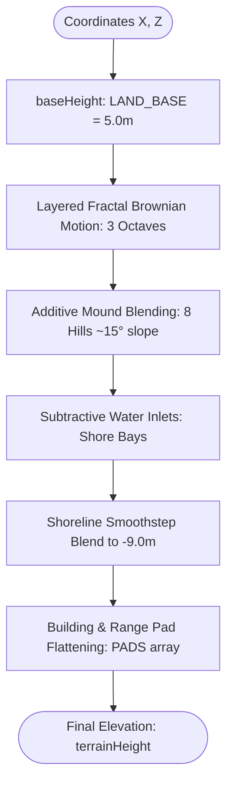
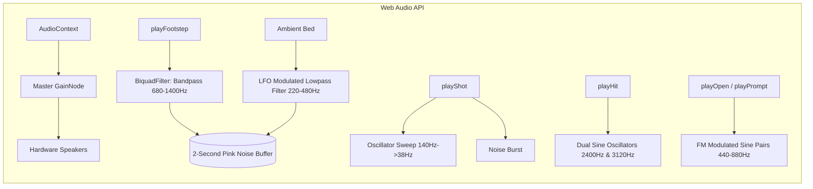
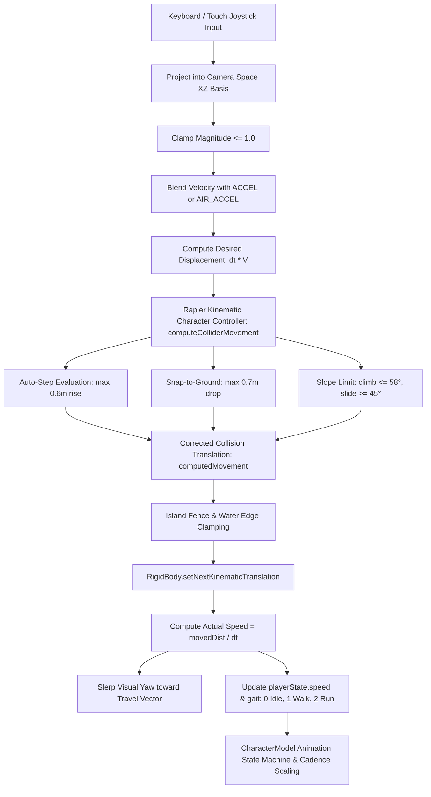
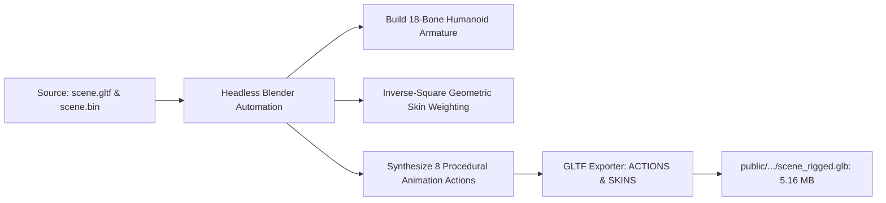
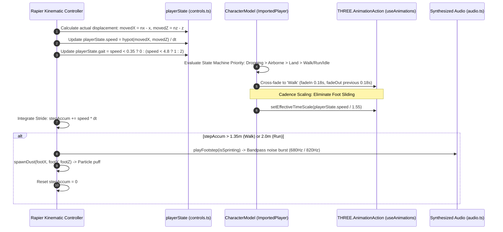
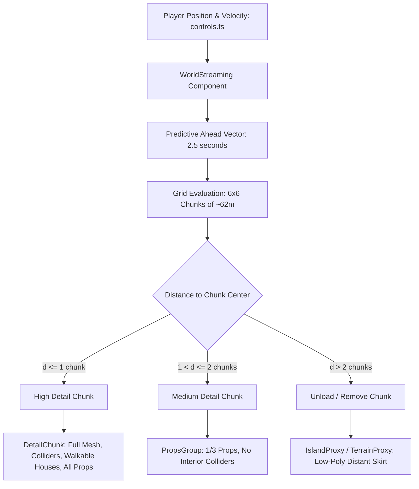
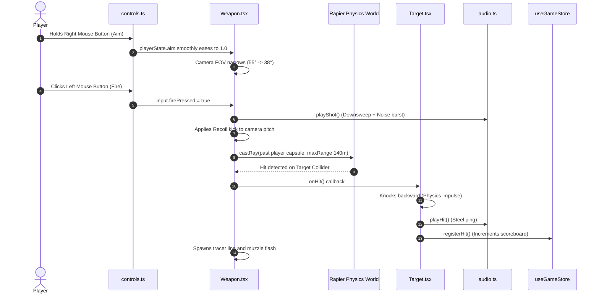
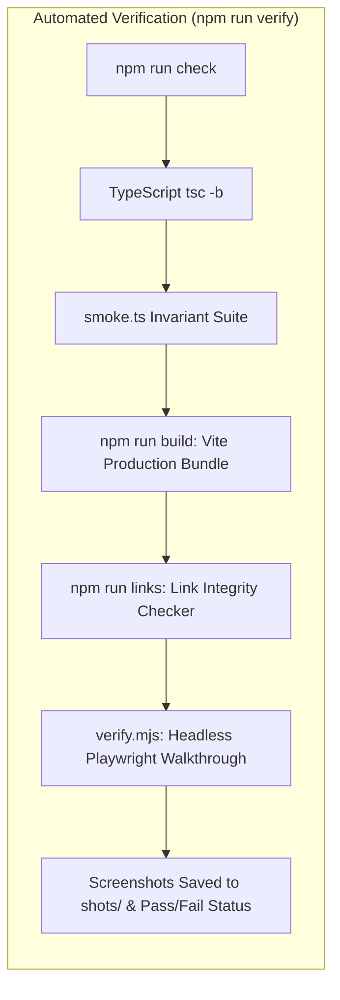

# Drop Zone — Technical Documentation & Architecture Reference

> **Drop Zone** is an interactive, fully procedural 3D battle-royale portfolio built with **React 18**, **Three.js**, **React Three Fiber (R3F)**, **React Three Rapier**, and **Tailwind CSS**. The application drops the visitor via parachute onto a procedurally generated island where they explore five distinct military compounds representing the portfolio sections: **About**, **Projects**, **Skills**, **Experience**, and **Contact**.

---

## Table of Contents

1. [Executive Summary & Core Philosophy](#1-executive-summary--core-philosophy)
2. [High-Level Architecture & Tech Stack](#2-high-level-architecture--tech-stack)
3. [Project Directory & Module Structure](#3-project-directory--module-structure)
4. [Procedural Systems (Zero External Assets)](#4-procedural-systems-zero-external-assets)
   - 4.1. [Terrain Generation & Heightfield Engine (`src/lib/terrain.ts`)](#41-terrain-generation--heightfield-engine)
   - 4.2. [Procedural PBR Textures (`src/lib/textures.ts`)](#42-procedural-pbr-textures)
   - 4.3. [Synthesized Web Audio Engine (`src/lib/audio.ts`)](#43-synthesized-web-audio-engine)
   - 4.4. [Deterministic Prop Scatter (`src/lib/scatter.ts`)](#44-deterministic-prop-scatter)
5. [Character Physics, Model Pipeline & Animation Engine](#5-character-physics-model-pipeline--animation-engine)
   - 5.1. [Kinematic Character Controller (`src/components/experience/Character.tsx`)](#51-kinematic-character-controller)
   - 5.2. [Rigged Blood Raven X-Suit Model & Asset Pipeline (`CharacterModel.tsx`)](#52-rigged-blood-raven-x-suit-model--asset-pipeline)
   - 5.3. [Automated Blender Rigging & Animation Baking (`scripts/rig-player-model.py`)](#53-automated-blender-rigging--animation-baking)
   - 5.4. [Walking Animation Engine & Locomotion Mechanics](#54-walking-animation-engine--locomotion-mechanics)
   - 5.5. [Parachute Drop Sequence & Aerial Pose States](#55-parachute-drop-sequence--aerial-pose-states)
6. [Camera Rig & Collision Detection](#6-camera-rig--collision-detection)
   - 6.1. [Orbital Spring-Damped Follow Camera (`CameraRig.tsx`)](#61-orbital-spring-damped-follow-camera)
   - 6.2. [Boom Obstruction & Canopy Raycasting](#62-boom-obstruction--canopy-raycasting)
   - 6.3. [Indoor Boom Adaptation](#63-indoor-boom-adaptation)
7. [World Streaming & Level of Detail (LOD)](#7-world-streaming--level-of-detail-lod)
   - 7.1. [Spatial Partitioning Grid (`src/world/config.ts`)](#71-spatial-partitioning-grid)
   - 7.2. [Velocity-Predicted Streaming Engine (`WorldStreaming.tsx`)](#72-velocity-predicted-streaming-engine)
   - 7.3. [Instanced Chunk Rendering (`StreamedProps.tsx`, `DetailChunk.tsx`)](#73-instanced-chunk-rendering)
8. [Building Architecture & Walkable Interiors](#8-building-architecture--walkable-interiors)
   - 8.1. [Compound Layout & Pad Flattening](#81-compound-layout--pad-flattening)
   - 8.2. [Walkable 2-Storey Shell & Stairwells (`HouseInterior.tsx`)](#82-walkable-2-storey-shell--stairwells)
   - 8.3. [3D Altitude-Aware Proximity Triggers (`useProximity.ts`)](#83-3d-altitude-aware-proximity-triggers)
   - 8.4. [Shared PBR Materials (`materials.ts`)](#84-shared-pbr-materials)
9. [Shooting Range & Weapon Mechanics](#9-shooting-range--weapon-mechanics)
   - 9.1. [Raycast Weapon System (`Weapon.tsx`)](#91-raycast-weapon-system)
   - 9.2. [Physics Reactive Targets (`ShootingRange.tsx`, `Target.tsx`)](#92-physics-reactive-targets)
   - 9.3. [Dust & Particle Dynamics (`Dust.tsx`)](#93-dust--particle-dynamics)
10. [State Management & Input Architecture](#10-state-management--input-architecture)
    - 10.1. [Dual-State Architecture (Reactive vs Imperative Per-Frame)](#101-dual-state-architecture)
    - 10.2. [Reactive Store (`src/store/useGameStore.ts`)](#102-reactive-store)
    - 10.3. [Per-Frame Controls & Input Pipeline (`src/state/controls.ts`, `hooks/`)](#103-per-frame-controls--input-pipeline)
11. [User Interface & HUD Subsystems](#11-user-interface--hud-subsystems)
    - 11.1. [Tactical HUD (`Hud.tsx`) & Altimeter (`DropOverlay.tsx`)](#111-tactical-hud--altimeter)
    - 11.2. [Real-Time 2D Canvas Minimap (`Minimap.tsx`)](#112-real-time-2d-canvas-minimap)
    - 11.3. [Tactical Full Map Overlay (`FullMap.tsx`)](#113-tactical-full-map-overlay)
    - 11.4. [Modal Panels (`SectionModal.tsx`, `panels/`)](#114-modal-panels)
    - 11.5. [Mobile Touch Controls (`MobileControls.tsx`)](#115-mobile-touch-controls)
12. [Atmosphere, Rendering & Post-Processing](#12-atmosphere-rendering--post-processing)
    - 12.1. [Lighting & Dynamic Shadow Frustum (`Lighting.tsx`)](#121-lighting--dynamic-shadow-frustum)
    - 12.2. [Animated Ocean Surface (`Water.tsx`)](#122-animated-ocean-surface)
    - 12.3. [Contracting Zone Cylinder (`Zone.tsx`)](#123-contracting-zone-cylinder)
    - 12.4. [Post-Processing Stack (`PostFx.tsx`)](#124-post-processing-stack)
13. [Accessibility & WebGL Fallback Mode](#13-accessibility--webgl-fallback-mode)
14. [Data Layer & Content Authoring](#14-data-layer--content-authoring)
15. [Quality Assurance, Invariants & Verification Pipeline](#15-quality-assurance-invariants--verification-pipeline)
    - 15.1. [Geometric & Game Invariants (`scripts/smoke.ts`)](#151-geometric--game-invariants)
    - 15.2. [Headless E2E Browser Testing (`scripts/verify.mjs`, `visual-check.mjs`)](#152-headless-e2e-browser-testing)
    - 15.3. [Link Integrity & Asset Diagnostics (`scripts/check-links.mjs`)](#153-link-integrity--asset-diagnostics)
16. [Build, Deployment & Performance Optimization](#16-build-deployment--performance-optimization)

---

## 1. Executive Summary & Core Philosophy

**Drop Zone** transforms the standard online resume into an immersive 3D world inspired by battle-royale drop zones. Instead of navigating links or scrolling long feeds, visitors parachute onto a remote coastal plateau and explore physical compounds to discover the candidate's work and qualifications.

### Core Engineering Principles

1. **Procedural World & Optimized Character Pipeline**:
   - **100% Procedural Environment**: The island terrain, compound architecture, walkable interior stairwells, foliage, rocks, weapons, and particle systems are constructed entirely from Three.js primitives and custom buffer geometries with zero downloaded environment meshes.
   - **High-Fidelity Rigged Humanoid Operative**: The player avatar utilizes an optimized, rigged high-fidelity model (**Blood Raven X-Suit**, `/models/player/blood_raven_x_suit/scene_rigged.glb`) preloaded concurrently during initial boot. An automated Blender Python pipeline (`scripts/rig-player-model.py`) equips the mesh with an 18-bone humanoid armature, inverse-square skin weighting, and 8 procedural animation clips.
   - **No Downloaded Texture Images for Environment**: Normal maps, roughness maps, dirt roads, beach gradients, and terrain coloration are synthesized in JavaScript at runtime using fractal noise lattices and vertex colors.
   - **No External Audio Files (.mp3 / .wav)**: Every footstep, weapon blast, UI chime, wind gust, and ambient drone is synthesized using the browser's Web Audio API.
   - **Resilient Fallback**: Should GLTF parsing fail, a procedural capsule avatar automatically takes over via React Error Boundary without disrupting gameplay or physics.

2. **Strict Determinism**:
   - The entire world is governed by deterministic seeds (`src/lib/noise.ts`).
   - The heightfield, dirt roads, tree scatter, minimap coordinates, building pads, and collision hulls agree identically across sessions and viewport sizes.

3. **Performance First (60 FPS Target)**:
   - Draw call minimisation via hardware instancing (`<Instances>` and `InstancedMesh`).
   - Custom chunk-based LOD streaming system with velocity prediction.
   - Player-tracking directional shadow frustum (2048x2048) covering the active play area rather than stretching across the entire 300m world.
   - Complete pause of Three.js render loop (`frameloop="never"`) whenever content modals or full maps are open, zeroing GPU utilization when reading text.

---

## 2. High-Level Architecture & Tech Stack

```mermaid
graph TD
    User([User / Browser]) --> DOM[React DOM Root: src/App.tsx]
    
    subgraph "WebGL Canvas (Three.js / R3F)"
        Canvas[R3F Canvas] --> Scene[Scene Root]
        Scene --> Lighting[Lighting & Sky: Lighting.tsx]
        Scene --> Physics[Rapier Physics World: gravity [0, -24, 0]]
        
        Physics --> Terrain[Terrain & Heightfield: Terrain.tsx]
        Physics --> Streaming[World Streaming: WorldStreaming.tsx]
        Physics --> Chars[Kinematic Character Controller: Character.tsx]
        Physics --> Cam[Camera Rig: CameraRig.tsx]
        Physics --> Weapon[Weapon Raycast System: Weapon.tsx]
        
        Streaming --> Chunks[DetailChunk & StreamedProps]
        Streaming --> Houses[Walkable Houses: About, Projects, Skills, Exp, Contact]
        Streaming --> Range[Shooting Range & Reactive Targets]
        
        Scene --> Water[Flat-Shaded Ocean: Water.tsx]
        Scene --> Zone[Contracting Blue Zone: Zone.tsx]
        Scene --> Dust[Dust & Particle Manager: Dust.tsx]
        Scene --> Proximity[3D Proximity Detection: useProximity.ts]
        Scene --> PostFx[Post-Processing Composer: PostFx.tsx]
    end
    
    subgraph "Tactical HUD & UI Layer (Tailwind & Framer Motion)"
        DOM --> LoadingScreen[Loading Screen: LoadingScreen.tsx]
        DOM --> Hud[HUD: Health/Shield, Callsign, Objectives: Hud.tsx]
        DOM --> Minimap[Minimap Canvas 2D: Minimap.tsx]
        DOM --> FullMap[Tactical Full Map Overlay: FullMap.tsx]
        DOM --> Crosshair[Adaptive Crosshair: Crosshair.tsx]
        DOM --> Prompt[Interaction Prompt 'PRESS E': InteractionPrompt.tsx]
        DOM --> Modals[Content Modal Panels: SectionModal.tsx]
        DOM --> Touch[Mobile On-Screen Controls: MobileControls.tsx]
        DOM --> Altimeter[Drop Altimeter Overlay: DropOverlay.tsx]
        DOM --> Fallback[No-WebGL Fallback Shell: FallbackShell.tsx]
    end
    
    subgraph "State Systems"
        ZustandStore[(Zustand Store: useGameStore.ts)]
        FrameControls[(Per-Frame Imperative State: controls.ts)]
    end
    
    Chars -.-> FrameControls
    Cam -.-> FrameControls
    Weapon -.-> FrameControls
    Proximity --> ZustandStore
    Hud --> ZustandStore
    Modals --> ZustandStore
    LoadingScreen --> ZustandStore
```

### Core Technologies

| Technology | Version | Purpose |
|---|---|---|
| **React** | `^18.3.1` | Component lifecycle, UI modals, DOM tree management |
| **Three.js** | `^0.169.0` | 3D rendering core, scene graph, materials, geometries, math |
| **@react-three/fiber** | `^8.18.0` | React reconciler for Three.js scene graph |
| **@react-three/drei** | `^9.122.0` | Helpers (`AdaptiveDpr`, `PerformanceMonitor`, `useProgress`) |
| **@react-three/rapier** | `^1.5.0` | WASM-powered Rapier 3D physics engine and kinematic controllers |
| **@react-three/postprocessing** | `^2.19.1` | Screen-space post-processing (`N8AO`, `Bloom`, `ToneMapping`, `SMAA`) |
| **Zustand** | `^4.5.7` | UI-facing global state management |
| **Framer Motion** | `^11.18.2` | Tactical UI micro-animations and panel transitions |
| **Tailwind CSS** | `^3.4.19` | Tactical military styling, layout tokens, HUD aesthetics |
| **Vite** | `^8.1.1` | Ultra-fast development server, asset pipeline, production bundling |
| **Playwright** | `^1.62.0` | Headless automated verification and walkthrough scripts |

---

## 3. Project Directory & Module Structure

```
c:\work\3d website\
├── models/                     # Raw player model source assets
│   └── player/
│       └── blood_raven_x_suit/ # Source GLTF, binary buffer, and 4K/2K PBR textures
├── public/                     # Static files (og.png, favicon, resume.pdf)
│   └── models/player/blood_raven_x_suit/
│       └── scene_rigged.glb    # Rigged 18-bone animated avatar bundle (5.16 MB)
├── scripts/                    # Invariant checks, smoke tests, visual regression
│   ├── check-links.mjs         # Validates external links across portfolioData
│   ├── diag.mjs                # Diagnostic tools
│   ├── make-images.mjs         # Generates open-graph images and icons
│   ├── rig-player-model.py     # Headless Blender pipeline: armatures, skinning & animation synthesis
│   ├── shot-character.mjs      # Fast standalone character rendering test runner
│   ├── smoke.ts                # Asserts spatial, geometric, and content invariants
│   ├── verify.mjs              # Boots preview server and runs headless Playwright
│   └── visual-check.mjs        # Full automated browser walkthrough & screenshot test
├── src/
│   ├── App.tsx                 # Canvas configuration, fallback detection, root shell
│   ├── index.css               # Design tokens, tactical styling, scanlines, fonts
│   ├── main.tsx                # React root mount
│   ├── components/
│   │   ├── experience/         # Everything rendered inside R3F <Canvas>
│   │   │   ├── CameraRig.tsx   # Spring-damped third-person boom with collision
│   │   │   ├── Character.tsx   # Rapier kinematic character controller & drop physics
│   │   │   ├── CharacterModel.tsx # Blood Raven X-Suit GLTF loader, animation state machine & chute
│   │   │   ├── Dust.tsx        # Particle puff manager for footsteps and impacts
│   │   │   ├── Island.tsx      # World grouping (WorldStreaming, Water, Dust, Zone)
│   │   │   ├── Lighting.tsx    # Sun, dynamic shadow frustum, sky, and fog
│   │   │   ├── PostFx.tsx      # Post-processing pipeline (N8AO, Bloom, ACES)
│   │   │   ├── Props.tsx       # Instanced props (trees, rocks, boundary posts)
│   │   │   ├── Terrain.tsx     # Heightfield generation and chunk mesh builder
│   │   │   ├── Water.tsx       # Flat-shaded animated ocean mesh with normal chop
│   │   │   ├── Zone.tsx        # Battle-royale contracting energy cylinder
│   │   │   ├── houses/         # Compound structures and interior components
│   │   │   │   ├── AboutHouse.tsx      # Compound 1: Command Post
│   │   │   │   ├── ProjectsHouse.tsx   # Compound 2: Supply Warehouse
│   │   │   │   ├── SkillsHouse.tsx     # Compound 3: Armory
│   │   │   │   ├── ExperienceHouse.tsx # Compound 4: Training Ground
│   │   │   │   ├── ContactHouse.tsx    # Compound 5: Comms Tower
│   │   │   │   ├── HouseInterior.tsx   # Walkable two-storey building shell & stairs
│   │   │   │   ├── HouseMarker.tsx     # Exterior beacon with spinning icon & distance
│   │   │   │   ├── materials.ts        # Shared PBR weathering material library
│   │   │   │   └── parts.tsx           # Reusable building primitives & architectural blocks
│   │   │   └── range/          # Interactive weapon and shooting range
│   │   │       ├── ShootingRange.tsx   # Range layout, target stands, firing line
│   │   │       ├── Target.tsx          # Dynamic reactive targets with hinge joints
│   │   │       └── Weapon.tsx          # Raycast assault rifle with recoil & tracers
│   │   └── ui/                 # DOM-based tactical HUD layer (Tailwind & Framer)
│   │       ├── Crosshair.tsx          # Center HUD crosshair with aim-down-sight spread
│   │       ├── DropOverlay.tsx        # Altimeter & flight telemetry during drop
│   │       ├── FallbackShell.tsx      # Accessible full document mode for non-WebGL devices
│   │       ├── FullMap.tsx            # Fullscreen interactive map with pin dropping
│   │       ├── Hud.tsx                # Top status bar, mission objectives, controls legend
│   │       ├── InteractionPrompt.tsx  # 'PRESS [E] TO INSPECT' indicator
│   │       ├── LoadingScreen.tsx      # Boot log terminal and 'DROP IN' launch sequence
│   │       ├── Minimap.tsx            # Real-time Canvas 2D tactical radar
│   │       ├── MobileControls.tsx     # Virtual dual-touch joystick and action buttons
│   │       ├── SectionModal.tsx       # Modal panel container with sound triggers
│   │       └── panels/                # Detailed portfolio content views
│   │           ├── AboutPanel.tsx     # Dossier, stats, biography, focus areas
│   │           ├── ProjectsPanel.tsx  # Crate inspector, deep dive, tech badges, links
│   │           ├── SkillsPanel.tsx    # Armory loadout with categorized proficiency bars
│   │           ├── ExperiencePanel.tsx# Tactical timeline of education and career
│   │           └── ContactPanel.tsx   # Comms uplink, email, GitHub, LinkedIn links
│   ├── data/
│   │   └── portfolioData.ts    # Single source of truth for all resume & island data
│   ├── hooks/
│   │   ├── useKeyboardControls.ts  # Desktop key bindings (WASD, Shift, Space, E, M)
│   │   ├── usePointerLook.ts       # Mouse drag / touch look orbital controls
│   │   └── useProximity.ts         # 3D spatial trigger proximity calculation
│   ├── lib/
│   │   ├── audio.ts            # Web Audio API sound synthesizer
│   │   ├── constants.ts        # Speed, drop altitudes, physics parameters
│   │   ├── noise.ts            # Deterministic pseudo-random number generator & FBM
│   │   ├── scatter.ts          # Deterministic prop placement algorithms
│   │   ├── terrain.ts          # Height calculations, mound blending, dirt trail network
│   │   ├── textures.ts         # Procedural wrapping normal and roughness data textures
│   │   └── webgl.ts            # WebGL support detection utility
│   ├── state/
│   │   └── controls.ts         # Per-frame zero-overhead mutable gameplay state
│   ├── store/
│   │   └── useGameStore.ts     # Zustand store for reactive UI state
│   └── world/                  # Level of Detail (LOD) & streaming engine
│       ├── config.ts           # Chunk dimensions, streaming radius, and update timings
│       ├── DetailChunk.tsx     # Full-fidelity chunk loader (props, buildings, colliders)
│       ├── IslandProxy.tsx     # Low-detail proxy for unstreamed distant chunks
│       ├── manifest.ts         # Precalculated content index per chunk coordinate
│       ├── StreamedProps.tsx   # Aggregated instanced props per loaded chunk set
│       ├── StreamingDebug.tsx  # Performance and chunk status overlay (?debug)
│       └── WorldStreaming.tsx  # Velocity-predictive streaming tick controller
├── index.html                  # HTML entry point with tactical head metadata
├── package.json                # Project dependencies, scripts, and build targets
├── tailwind.config.js          # Custom colors (steel, flare, olive), tactical fonts
├── tsconfig.json               # TypeScript project reference root
└── vite.config.ts              # Vite plugins, chunking strategy, and SEO rewrites
```

---

## 4. Procedural Systems (Zero External Assets)

### 4.1. Terrain Generation & Heightfield Engine (`src/lib/terrain.ts`)

The island is generated entirely from code. A single mathematical function `terrainHeight(x, z)` acts as the absolute single source of truth for ground elevation across the entire application: the terrain mesh, Rapier physics colliders, building foundation pads, prop scatter, and character feet all query this function.



1. **Fractal Noise Baseline**:
   - Elevation begins at `LAND_BASE = 5.0m` above sea level (`seaLevel = -1.2m`).
   - Three octaves of value noise (`src/lib/noise.ts`) provide broad rolling contours, mid-level undulation, and micro-roughness.
2. **Deterministic Hills & Bays**:
   - 8 additive Gaussian mounds (`HILLS`) create elevated ridgelines reaching up to 18m elevation, with slopes calibrated around 15° (well within the character controller's 58° slope-climbing threshold).
   - 1 subtractive inlet (`INLETS`) carves a deep water inlet on the southern coast at `(0, 118)` with radius 34m, creating a natural coastal bay.
3. **Shoreline Falloff**:
   - Between `SHORE_START = 122m` and `SHORE_END = 172m`, elevation is smoothly interpolated down below sea level to `SHORE_DEPTH = -9.0m` via Hermite smoothstep interpolation.
4. **Building Pad Flattening**:
   - Houses and the shooting range cannot sit on tilted slopes without foundation gaps.
   - For every compound in `HOUSE_DEFS` and the shooting range `RANGE_ORIGIN`, a circular pad is defined with an inner radius (`PAD_INNER = 10.5m`) that is 100% flat at the building's anchor elevation, and an outer radius (`PAD_OUTER = 16.5m`) that smoothly blends back to natural terrain using Hermite interpolation.

#### Dirt Road Network & Terrain Vertex Coloring

Instead of allocating separate geometry meshes for roads (which introduce Z-fighting and extra draw calls), the dirt road network is encoded directly into the terrain's vertex colors:

- **Hub-and-Spoke + Ring Road Network**:
  - Spokes connect the central drop plaza `(0, 2)` to each compound door marker.
  - A circular perimeter road connects neighbouring compounds in angular order around the island (`RING`), allowing players to traverse between compounds without doubling back to the center.
- **Road Strength Function (`pathStrength(x, z)`)**:
  - Computes the minimum 2D Euclidean distance to any line segment in `PATH_SEGMENTS`.
  - Dirt density is 1.0 within `ROAD_CORE = 2.4m` and smoothly feathers to 0.0 at `ROAD_EDGE = 3.6m`.
- **Dynamic Vertex Color Blending (`groundColor`)**:
  - **Grass**: Three elevation-based hues (`#48562f`, `#5f6f3e`, `#79894f`).
  - **Rock Slopes**: Exposed grey rock (`#6b6b60`) on surface slopes exceeding 23° (`slope > 0.42`).
  - **Dirt Trails**: Earthy brown (`#6d5a3c`) blended proportional to `pathStrength(x, z)`.
  - **Beach & Wet Sand**: Golden sand (`#c9b98a`) along the shoreline, darkening to saturated wet sand (`#9d8e64`) below `y < seaLevel + 0.6m`.

### 4.2. Procedural PBR Textures (`src/lib/textures.ts`)

To avoid flat, plasticky surfaces, the application synthesizes 256x256 seamless normal and roughness maps at startup:

- **Lattice-Wrapping Value Noise (`wrapNoise`)**:
  - Unlike unbounded noise, `wrapNoise` computes values on a periodic grid (`PERIOD = 8`), guaranteeing that UV coordinates wrap seamlessly from `1.0` back to `0.0` with zero visual seams.
- **Surface Maps Generated**:
  - **Heightfield**: 4 octaves of wrapped fractional Brownian motion (`fbmWrapped`).
  - **Normal Map (`DataTexture`)**: Computed via Sobel-like finite differences:
    $$\Delta x = h(u + \epsilon, v) - h(u - \epsilon, v), \quad \Delta y = h(u, v + \epsilon) - h(u, v - \epsilon)$$
    Encoded into RGB channels as normalized directional vectors.
  - **Roughness Map (`DataTexture`)**: Derived from the inverted height gradient, causing micro-crevices to retain grit and diffuse light differently from flat ridges.
- **Shared Sampler (`tiled(kind, density)`)**:
  - A single normal/roughness pair is instantiated once in GPU memory and reused by all buildings, concrete aprons, and props via texture matrix repeat tiling (`RepeatWrapping`).

### 4.3. Synthesized Web Audio Engine (`src/lib/audio.ts`)

The audio engine produces rich acoustic feedback without downloading a single sound file:



- **Pink Noise Buffer (`getNoise`)**:
  - Generates a 2-second looped audio buffer using the Paul Kellet 3-pole filter approximation, producing natural acoustic noise rather than harsh white static.
- **Footstep Synthesis (`playFootstep`)**:
  - Triggers brief 45ms noise bursts through a bandpass filter (`Q = 3.2`) that alternates pitch slightly (680Hz to 820Hz) to simulate left/right foot cadence on packed earth.
- **Weapon & Impact Audio**:
  - **Gunshot (`playShot`)**: A punchy 140Hz-to-38Hz downward frequency sweep layered over an aggressive low-pass noise transient.
  - **Target Hit (`playHit`)**: High-frequency dual sine pings (2400Hz and 3120Hz) with rapid exponential gain decay, recreating the ring of bullet striking a steel shooting target.
- **Ambient Wind (`startAmbient`)**:
  - Continuous pink noise driven through a resonant low-pass filter modulated by a slow 0.08Hz Low Frequency Oscillator (LFO), providing the subtle wind backdrop of an exposed island.

### 4.4. Deterministic Prop Scatter (`src/lib/scatter.ts`)

Props are positioned across the island using deterministic pseudo-random distribution:

- **Prop Catalog**:
  - `TREES`: Low-poly oak/deciduous trees with multi-sphere foliage canopies.
  - `PINES`: Conical pine trees with tiered foliage skirts.
  - `BROADLEAF`: Wide-canopy coastal trees.
  - `BUSHES`: Ground-level foliage clusters.
  - `ROCKS` & `SHORE_ROCKS`: Granite boulders and coastal breaker stones.
  - `TUFTS`: Low-poly grass clumps scattered across trails and ridges.
  - `DEBRIS`: Wooden crates, pallets, and fuel drums scattered around compounds.
  - `BOUNDARY_POSTS`: Concrete hazard pylons delineating the perimeter.
- **Placement Rules**:
  - Clears building compound perimeters (`clearOfHouses`) by at least 13 meters.
  - Suppresses foliage on dirt paths (`pathStrength < maxPath`) to keep walking routes clear.
  - Clamps elevation above the waterline (`minHeight > -0.4m`).
  - Enforces minimum spacing between instances using a 2D spatial hash grid.

---

## 5. Character Physics, Model Pipeline & Animation Engine

### 5.1. Kinematic Character Controller (`src/components/experience/Character.tsx`)

Player traversal is governed by **Rapier 3D**'s dedicated kinematic character controller rather than a dynamic rigid body. In 3D exploration environments, dynamic rigid bodies subject to standard Newtonian force integration present numerous gameplay hazards: bouncing unpredictably over polygonal terrain seams, clinging or sticking to vertical walls, tipping over on staircases, and suffering from sluggish input response. 

The kinematic controller provides sharp, responsive, arcade-grade locomotion with direct displacement integration:



#### Kinematic Capsule Geometry & Offsets

- **Capsule Collider Dimensions**:
  - Radius: `CAPSULE_RADIUS = 0.42m`
  - Half-Height: `CAPSULE_HALF = 0.54m`
  - Total Collider Height: $2 \times (\text{CAPSULE\_HALF} + \text{CAPSULE\_RADIUS}) = 1.92\text{m}$
- **Visual Center & Ground Contact Offset**:
  - The Rapier capsule's origin sits at its volumetric center ($y = 0$).
  - The physical contact point with the ground sits at `-FEET_OFFSET = -(CAPSULE_HALF + CAPSULE_RADIUS) = -0.96m`.
  - The visual mesh root group (`CharacterYawRoot`) is offset by `[0, -FEET_OFFSET, 0]`, aligning the bottom soles of the character's boots with the exact physical ground contact plane.

#### Controller Configuration Parameters

```typescript
const c = w.createCharacterController(0.02) // 0.02m skin offset
c.setUp({ x: 0, y: 1, z: 0 })
c.enableAutostep(0.6, 0.3, true)
c.enableSnapToGround(0.7)
c.setMaxSlopeClimbAngle((58 * Math.PI) / 180)
c.setMinSlopeSlideAngle((45 * Math.PI) / 180)
c.setApplyImpulsesToDynamicBodies(true)
c.setCharacterMass(75)
c.setSlideEnabled(true)
```

1. **Auto-Stepping (`enableAutostep(0.6, 0.3, true)`)**:
   - Allows the character to seamlessly climb curbs, porch foundations, and interior stair risers up to **0.6m high**, provided the horizontal surface is at least **0.3m deep**.
   - Enables natural ascent of the 12-step interior stairwells without requiring manual jump inputs.
2. **Ground Snapping (`enableSnapToGround(0.7)`)**:
   - Evaluates a vertical downward sweep of **0.7m** when grounded.
   - Glues the character capsule to descending topography, eliminating airborne jitter when sprinting downhill.
3. **Slope Thresholds**:
   - `setMaxSlopeClimbAngle(58°)`: Grants free exploration of authored rolling hills (~15° slope) while preventing players from walking up steep mountain ridgelines or sheer cliff faces.
   - `setMinSlopeSlideAngle(45°)`: Induces downward sliding when standing on acute terrain inclines.
4. **Dynamic Mass & Impulses (`setCharacterMass(75)`)**:
   - Configures the operative with a physical mass of 75kg.
   - When the kinematic capsule collides with dynamic objects (such as target stands, fuel barrels, or wooden debris at the shooting range), Rapier transfers realistic impulse forces, scattering clutter naturally.

#### Kinematic Velocity Integration & Boundary Containment

- **Locomotion Kinematics**:
  - Horizontal Acceleration: `ACCEL = 14 m/s²` on ground; `AIR_ACCEL = 3.5 m/s²` in air.
  - Velocities: `WALK_SPEED = 3.6 m/s` (~13.0 km/h), `RUN_SPEED = 6.8 m/s` (~24.5 km/h).
  - Gravity & Jump: `GRAVITY = -24 m/s²`, `JUMP_V = 8.4 m/s`, terminal falling velocity clamped to `-45 m/s`.
  - Jump input behaves as a rising-edge trigger: consumed immediately upon execution to prevent queued jumps on landing.
- **Island Boundary Clamping**:
  - A circular fence boundary is enforced at `ISLAND.boundary = 148m`.
  - If horizontal radius $r = \sqrt{x^2 + z^2} > \text{boundary}$, the position is projected radially inward ($x \times \frac{\text{boundary}}{r}$), causing the player to slide smoothly along the outer perimeter.
- **Water Exclusion & Shoreline Sliding**:
  - The shoreline inlet penetrates inside the circular boundary. To prevent the camera and character from being submerged beneath the opaque sea plane, `isSubmerged(x, z)` tests ground elevation against `seaLevel = -1.2m`.
  - When water penetration is detected, the controller retries each coordinate axis independently ($x$ then $z$). This enables the operative to slide fluidly along the water's edge rather than sticking abruptly to the shoreline.
- **Under-World Safety Net**:
  - If an extreme frame drop or collision anomaly pushes $y$ below `terrainHeight(x, z) + FEET_OFFSET - 0.15m`, the character is instantly clamped to the surface and vertical velocity is reset to zero.

---

### 5.2. Rigged Blood Raven X-Suit Model & Asset Pipeline (`CharacterModel.tsx`)

The player character is rendered using an optimized, battle-tested 3D sci-fi operative model: the **Blood Raven X-Suit** (`/models/player/blood_raven_x_suit/scene_rigged.glb`). The asset features carbon-fiber reinforced exosuit plating, tactical pouches, a high-altitude jump pack, reinforced combat boots, and HUD-linked combat optics.

```
c:\work\3d website\public\models\player\blood_raven_x_suit\
├── license.txt                 # CC-BY Attribution & asset origin metadata
├── scene.gltf                  # Original raw GLTF 2.0 unskinned mesh hierarchy
├── scene.bin                   # Binary vertex buffer data (1.15 MB)
├── textures/                   # 4K & 2K PBR material maps
│   ├── mat0_baseColor.png
│   ├── mat0.002_baseColor.png ... mat0.006_baseColor.png
│   └── mat0.006_metallicRoughness.png
└── scene_rigged.glb            # Headless Blender export: Armature + Skinned Mesh + 8 Actions (5.16 MB)
```

#### Preloading & Cache Architecture

To achieve zero visual pop-in when the visitor transitions from the loading terminal to the 3D scene:

```typescript
const PLAYER_MODEL_URL = '/models/player/blood_raven_x_suit/scene_rigged.glb'

// Initiates background fetch while loading screen is visible
useGLTF.preload(PLAYER_MODEL_URL)
```

- `useGLTF` and `useGLTF.preload` share `@react-three/drei`'s global `useLoader` cache.
- The 5.16 MB GLB asset is requested **exactly once** during the initial boot sequence (strictly asserted by the headless verification test `scripts/visual-check.mjs`).
- Subsequent component remounts or hot-reloads retrieve the decoded skeleton, materials, and textures directly from memory without network overhead.

#### Dynamic Bounding Box Normalization & Ground Contact Alignment

Imported 3D assets authored in external software (such as Blender, Maya, or 3ds Max) often exhibit arbitrary bounding scales, coordinate axes, and origin placements. Rather than relying on fragile manual guesswork, `CharacterModel.tsx` runs an automated calibration pass inside a `useMemo` hook:

```typescript
const calibration = useMemo<Calibration>(() => {
  scene.updateMatrixWorld(true)
  scene.traverse((object) => {
    if ('isMesh' in object && object.isMesh) {
      object.castShadow = true
      object.receiveShadow = true
    }
  })

  const bounds = new Box3().setFromObject(scene)
  const size = bounds.getSize(new Vector3())
  const scale = PLAYER_HEIGHT / Math.max(size.y, 0.001)
  return { scale, yOffset: -bounds.min.y * scale }
}, [scene])
```

1. **Shadow Frustum Integration**:
   - Recursively traverses all sub-meshes to flag `castShadow = true` and `receiveShadow = true`.
   - Projects crisp dynamic contact shadows onto the terrain, building floors, and exterior ramps.
2. **Uniform Height Scaling**:
   - Measures raw mesh height via `Box3.getSize().y` (Blender source measures 190.7 units).
   - Computes uniform scale factor:
     $$\text{scale} = \frac{\text{PLAYER\_HEIGHT}}{\max(\text{size.y}, 0.001)} = \frac{1.85}{190.7} \approx 0.009701$$
   - Normalizes the character to an exact tactical height of **1.85 meters**.
3. **Sole-to-Capsule Ground Alignment**:
   - Finds the absolute lowest vertex in the model: `bounds.min.y`.
   - Computes vertical offset: `yOffset = -bounds.min.y * scale`.
   - Translates the mesh so the soles of the combat boots sit precisely at $y = 0$ in the visual group's coordinate frame, matching Rapier's `-FEET_OFFSET`.
4. **Coordinate System Orientation Reconciliation**:
   - Blender's default forward orientation is $+Y$ (Z-up), whereas Three.js / R3F camera forward is $-Z$ (Y-up).
   - `MODEL_YAW_OFFSET = Math.PI` (180° rotation) is applied strictly at the visual wrapper root (`PlayerModelCorrectionRoot`):
     ```tsx
     <group name="PlayerModelCorrectionRoot" rotation={[0, MODEL_YAW_OFFSET, 0]}>
       <group name="BloodRavenVisual" scale={calibration.scale} position={[0, calibration.yOffset, 0]}>
         <primitive object={scene} dispose={null} />
       </group>
     </group>
     ```
   - This fixed geometric correction is entirely decoupled from the runtime directional yaw calculated by `Character.tsx`, preventing coordinate inversion bugs.

#### Resilient React Error Boundary (`PlayerModelErrorBoundary`)

If a visitor experiences network corruption, restrictive CDN firewalls, or out-of-memory errors while loading the GLB model, the application does not crash. `PlayerModelErrorBoundary` intercepts the exception and mounts a procedural fallback capsule:

```tsx
<mesh name="PlayerModelFallback" position={[0, 0.9, 0]} castShadow>
  <capsuleGeometry args={[0.32, 1.15, 4, 8]} />
  <meshStandardMaterial color="#f0a92e" roughness={0.8} />
</mesh>
```

The Rapier physics controller, camera boom, interaction triggers, HUD altimeter, and minimap continue running uninterrupted.

---

### 5.3. Automated Blender Rigging & Animation Baking (`scripts/rig-player-model.py`)

The source asset (`scene.gltf`) was an unskinned static mesh without skeletal hierarchy or animation tracks. To produce a fully functional game character, the repository includes a custom, headless **Blender Python automation pipeline** (`scripts/rig-player-model.py`).



#### 18-Bone Humanoid Armature (`BloodRaven_Rig`)

The script constructs an articulated humanoid skeleton scaled to the character's geometry:

| Bone Name | Head Position $[X, Y, Z]$ | Tail Position $[X, Y, Z]$ | Parent Bone | Deform |
|---|---|---|---|---|
| `Root` | $[0, 0, 0]$ | $[0, 0, 92]$ | *None* | `false` |
| `Hips` | $[0, 0, 91]$ | $[0, 0, 111]$ | `Root` | `true` |
| `Spine` | $[0, 0, 105]$ | $[0, 0, 137]$ | `Hips` | `true` |
| `Chest` | $[0, 0, 137]$ | $[0, 0, 153]$ | `Spine` | `true` |
| `Neck` | $[0, 0, 153]$ | $[0, 0, 165]$ | `Chest` | `true` |
| `Head` | $[0, 0, 163]$ | $[0, 0, 181]$ | `Neck` | `true` |
| `LeftUpperLeg` / `RightUpperLeg` | $[\mp 12, 0, 101]$ | $[\mp 15, 0, 57]$ | `Hips` | `true` |
| `LeftLowerLeg` / `RightLowerLeg` | $[\mp 15, 0, 57]$ | $[\mp 14, 0, 16]$ | `UpperLeg` | `true` |
| `LeftFoot` / `RightFoot` | $[\mp 14, 0, 16]$ | $[\mp 14, 12, 7]$ | `LowerLeg` | `true` |
| `LeftToe` / `RightToe` | $[\mp 14, 12, 7]$ | $[\mp 14, 21, 6]$ | `Foot` | `true` |
| `LeftUpperArm` / `RightUpperArm` | $[\mp 18, 0, 147]$ | $[\mp 34, 0, 126]$ | `Chest` | `true` |
| `LeftLowerArm` / `RightLowerArm` | $[\mp 34, 0, 126]$ | $[\mp 32, 2, 105]$ | `UpperArm` | `true` |
| `LeftHand` / `RightHand` | $[\mp 32, 2, 105]$ | $[\mp 31, 7, 97]$ | `LowerArm` | `true` |

All bone rolls are aligned to the positive X-axis (`align_roll(Vector((1, 0, 0)))`), establishing standardized local rotation axes across symmetrical limbs.

#### Inverse-Square Geometric Skin Weighting Engine

Rather than relying on manual weight painting or naive heat-map diffusion (which often fails on disconnected clothing shells and armor panels), the pipeline computes skin weights using **point-to-segment geometric projection**:

1. **Point-to-Segment Euclidean Distance (`point_segment_distance`)**:
   For every vertex $P$ in the mesh and bone line segment $AB$:
   $$t = \text{clamp}\left(\frac{(P - A) \cdot (B - A)}{\|B - A\|^2}, 0, 1\right), \quad d(P, AB) = \|P - (A + t(B - A))\|$$
2. **Inverse-Square Falloff**:
   Calculates influence across the 3 nearest candidate bones:
   $$w_i = \frac{1}{\max(d_i, 1.5)^2}, \quad \hat{w}_i = \frac{w_i}{\sum_{j=1}^3 w_j}$$
   This produces smooth, non-pinching joint deformations at the knees, elbows, and hips, while ensuring disconnected armor plates stay bound to their underlying limbs.
3. **Partitioned Mesh Binding**:
   - **`Top*` (Upper Gear)**: Weighted against upper chain (`Hips`, `Spine`, `Chest`, `Neck`, `Head`, arms, hands).
   - **`Pant*` (Trousers & Boots)**: Weighted against lower chain (`Hips`, legs, feet, toes).
   - **`HEAD*` / `Mask*`**: 100% rigid-bound (`weight = 1.0`) to `Head` bone to prevent optical distortion of the visor.
   - **`Bag*` (Tactical Jump Pack)**: 100% rigid-bound to `Chest` bone.
   - **Holsters & Pouches**: 100% rigid-bound to `Spine`.

#### Synthesized Animation Clips Catalog

Eight distinct animation actions are mathematically baked into the GLB bundle:

| Action Name | Frame Length | Looping Mode | Description |
|---|---|---|---|
| **`Idle`** | 48 frames (2.0s) | `LoopRepeat` | Natural breathing sway, subtle spine torsion ($0.012\sin$), hips vertical cycle |
| **`Walk`** | 24 frames (1.0s) | `LoopRepeat` | Tactical cadence, 1.55m authored travel, reciprocal arm/leg swings, pelvic bob |
| **`Run`** | 24 frames (1.0s) | `LoopRepeat` | Extended forward stride, 3.2m authored travel, deep knee drive, aggressive lean |
| **`Jump`** | 18 frames (0.75s) | `LoopOnce` | Crouch anticipation, upward ballistic extension, arm lift |
| **`Fall`** | 12 frames (0.5s) | `LoopRepeat` | Airborne stabilization pose, leg splay, outward arm balance |
| **`Land`** | 13 frames (0.54s) | `LoopOnce` | Impact compression, knee flexion, torso forward flexion, hip dampening |
| **`Freefall`** | 12 frames (0.5s) | `LoopRepeat` | High-altitude belly-to-earth skydiver arch, arms swept, legs extended |
| **`Parachute`** | 12 frames (0.5s) | `LoopRepeat` | Vertical harness suspension pose, hands reaching upward holding risers |

All keyframes use Bézier curves with auto-clamped tangent handles (`AUTO_CLAMPED`) to guarantee smooth derivative acceleration across cycles.

---

### 5.4. Walking Animation Engine & Locomotion Mechanics

The walking animation system bridges Rapier's physical simulation and Three.js's skeletal animation. It ensures that the visual operative never slides, floats, or cycles their feet into walls.



#### Harmonic Walk Cycle Formulation

The walking cycle (`gait_pose` in `scripts/rig-player-model.py`) is synthesized using harmonic biomechanical equations evaluated over a normalized phase angle $\phi \in [0, 2\pi]$:

$$\phi = \frac{\text{frame} - 1}{24} \times 2\pi$$

```python
phase = (frame - 1) / 24 * math.tau
swing = math.sin(phase)
cosine = math.cos(phase)
```

1. **Hip Swing (Upper Legs)**:
   $$\theta_{\text{hip\_left}} = \text{hip\_amp} \times \sin(\phi), \quad \theta_{\text{hip\_right}} = -\text{hip\_amp} \times \sin(\phi)$$
   The left and right thighs oscillate in perfect opposition. For the walk cycle, $\text{hip\_amp} = 0.45\text{ rad}$ (~25.8°); for the run cycle, $\text{hip\_amp} = 0.78\text{ rad}$ (~44.7°).
2. **Knee Flexion (Lower Legs)**:
   $$\theta_{\text{knee\_left}} = -\text{knee\_amp} \times \max(0, \cos(\phi)), \quad \theta_{\text{knee\_right}} = -\text{knee\_amp} \times \max(0, -\cos(\phi))$$
   **Non-Linear Biomechanical Clamp**: Real human knees flex backward during the forward swing phase to allow foot ground clearance, but lock straight during the weight-bearing stance phase. The half-wave rectification $\max(0, \pm\cos(\phi))$ guarantees that:
   - When the thigh swings forward, the knee flexes smoothly up to $\text{knee\_amp} = 0.8\text{ rad}$ (~45.8°).
   - When the foot is planted on the ground carrying the body's weight, the knee rotation is strictly $0\text{ rad}$, preventing backward hyperextension.
3. **Ankle & Foot Articulation**:
   $$\theta_{\text{foot\_left}} = \text{knee\_amp} \times \max(0, \cos(\phi)) \times 0.18, \quad \theta_{\text{foot\_right}} = \text{knee\_amp} \times \max(0, -\cos(\phi)) \times 0.18$$
   Slight upward pitch (dorsiflexion) during the swing phase ensures toe clearance above terrain micro-bumps.
4. **Counter-Arm Swing & Elbow Flexion**:
   $$\theta_{\text{arm\_left}} = -\text{arm\_amp} \times \sin(\phi), \quad \theta_{\text{arm\_right}} = \text{arm\_amp} \times \sin(\phi)$$
   $$\theta_{\text{elbow\_left}} = -\text{elbow\_amp} \times 0.6 \times (0.5 - 0.5\sin(\phi))$$
   Arms oscillate opposite their corresponding legs to counterbalance angular momentum. The elbows remain bent at a tactical low-ready readiness angle throughout traversal.
5. **Pelvic Twist & Dual-Crest Vertical Bobbing**:
   $$\text{twist}_{\text{hips}} = \text{twist\_amp} \times \sin(\phi)$$
   $$\Delta z_{\text{hips}} = \text{bob\_amp} \times \cos(2\phi)$$
   - The pelvis twists slightly along the vertical axis ($\text{twist\_amp} = 0.05\text{ rad}$), tracking leg extension.
   - Pelvic vertical bobbing operates at **double the stride frequency ($2\phi$)**: the hips rise to their apex during mid-stance (when standing on one straightened leg) and drop to their lowest nadir during double-support impact (when both feet touch the ground).

#### Gait Comparison: Walk vs. Run Parameters

| Metric / Joint Parameter | Walk Action (`Walk`) | Run Action (`Run`) | Biomechanical Purpose |
|---|---|---|---|
| **Authored Displacement** | `1.55m` per loop | `3.20m` per loop | Calibrates foot travel to real world units |
| **Hip Swing Amplitude (`hip_amp`)** | `0.45 rad` (~25.8°) | `0.78 rad` (~44.7°) | Wider forward/backward leg travel |
| **Knee Flexion (`knee_amp`)** | `0.80 rad` (~45.8°) | `0.72 rad` (~41.2°) | Dynamic heel kick during recovery |
| **Arm Swing Amplitude (`arm_amp`)** | `0.35 rad` (~20.0°) | `0.55 rad` (~31.5°) | Greater counter-balance momentum |
| **Elbow Flexion (`elbow_amp`)** | `0.50 rad` | `0.50 rad` | Tactical weapon-ready arm posture |
| **Pelvic Vertical Bob (`bob_amp`)** | `3.0 cm` | `1.8 cm` | Center of mass oscillation |
| **Pelvic Twist (`twist_amp`)** | `0.05 rad` (~2.9°) | `0.07 rad` (~4.0°) | Hip yaw rotation into stride |
| **Spine Counter-Twist** | `0.025 rad` ($\sin 2\phi$) | `0.025 rad` ($\sin 2\phi$) | Decouples torso aim from hip sway |

#### Real-Time Locomotion State Machine

Every frame in `useFrame`, `CharacterModel.tsx` evaluates input flags, velocity vectors, and physics states:

```typescript
let state: string
if (dropping) {
  state = playerState.y < CHUTE_ALTITUDE ? 'Parachute' : 'Freefall'
} else if (!playerState.grounded) {
  state = playerState.verticalVelocity > 0.45 ? 'Jump' : 'Fall'
} else if (performance.now() - playerState.landedAt < 420 && playerState.landedAt > 0) {
  state = 'Land'
} else {
  state = playerState.speed > 0.35
    ? (playerState.gait === 2 ? 'Run' : 'Walk')
    : 'Idle'
}
```

- **Priority Hierarchy**:
  1. `dropping`: Chute deployment ($y < 34\text{m}$) vs Freefall.
  2. `!grounded`: Jump ($V_y > 0.45\text{ m/s}$) vs Airborne Fall ($V_y \le 0.45\text{ m/s}$).
  3. `Land`: Plays impact absorption clip for **420ms** immediately following touchdown.
  4. `grounded`: Idle ($\text{speed} \le 0.35\text{ m/s}$), Walk ($0.35 < \text{speed} \le 4.8\text{ m/s}$), or Run ($\text{speed} > 4.8\text{ m/s}$ / `sprint` active).

#### Animation Cross-Fading & Loop Policies

When transitioning between states (e.g. from `Idle` into `Walk`):

```typescript
const looping = ['Idle', 'Fall', 'Freefall', 'Parachute'].includes(state)
next.reset()
next.enabled = true
next.setLoop(looping ? LoopRepeat : LoopOnce, looping ? Infinity : 1)
next.clampWhenFinished = !looping
next.setEffectiveWeight(1)
next.setEffectiveTimeScale(1)
next.fadeIn(0.18).play()
activeAction.current?.fadeOut(0.18)
activeAction.current = next
activeState.current = state
```

- **Smooth 180ms Blend**: `fadeIn(0.18)` and `fadeOut(0.18)` smoothly interpolate skeletal bone quaternions, eliminating sudden pop artifacts.
- **Looping vs Clamping**:
  - Continuous states (`Idle`, `Fall`, `Freefall`, `Parachute`, `Walk`, `Run`) loop seamlessly (`LoopRepeat`).
  - Transient impulses (`Jump`, `Land`) play once (`LoopOnce`) and hold their final pose (`clampWhenFinished = true`) until the state machine transitions out.

#### Foot-Sliding Elimination & Cadence Scaling

A pervasive problem in 3D web character controllers is **foot sliding** (skating), which occurs when a character moves through the world at a speed that does not match the playback speed of their walking animation. Furthermore, if a player walks into a wall, standard input-driven systems continue to play the walk animation while the character remains stationary.

Drop Zone eliminates this through a two-tiered architectural coupling:

1. **Rapier Kinematic Displacement as Truth**:
   In `Character.tsx`, `playerState.speed` is calculated from **actual displacement**, not desired velocity:
   ```typescript
   const movedX = nx - pos.x
   const movedZ = nz - pos.z
   const speed = Math.hypot(movedX, movedZ) / Math.max(dt, 1e-4)
   playerState.speed = speed
   ```
   If the character runs against a solid concrete building wall or steep boulder, Rapier's `computeColliderMovement` stops forward progress ($nx = \text{pos.x}, nz = \text{pos.z}$). Consequently, `playerState.speed` immediately drops to $0.0\text{ m/s}$.
2. **Dynamic Cadence Matching**:
   In `CharacterModel.tsx`, the animation playback time scale is dynamically modulated to match actual horizontal speed against the authored stride length:
   ```typescript
   if (state === 'Walk') activeAction.current?.setEffectiveTimeScale(playerState.speed / 1.55)
   else if (state === 'Run') activeAction.current?.setEffectiveTimeScale(playerState.speed / 3.2)
   ```
   - At normal walk speed ($3.6\text{ m/s}$), the animation plays at $\frac{3.6}{1.55} \approx 2.32\times$ speed.
   - On a slow mobile joystick push ($1.55\text{ m/s}$), the animation plays at exactly $1.0\times$ speed.
   - When blocked by a wall or obstacle, `speed` falls below $0.35\text{ m/s}$, bringing the walk animation to a complete halt and triggering a clean 180ms cross-fade back to `Idle`!

#### Acoustic & Visual Step Synchronization

Footstep audio and dust emissions are driven by **distance travelled**, rather than elapsed time, ensuring that footsteps stay in lockstep with the visual gait:

- **Distance Accumulator**: `stepAccum.current += speed * dt`
- **Stride Distance Thresholds**:
  - Walk Stride: `1.35 meters`
  - Run Stride: `2.00 meters`
- **Synchronized Feedback**:
  When `stepAccum > stride`:
  - Triggers `playFootstep(gait === 2)`: synthesizes an acoustic 45ms bandpassed noise burst alternating between 680Hz and 820Hz to simulate left/right boot impacts on packed soil.
  - Calls `spawnDust(nx, ny - FEET_OFFSET, nz, intensity)`: emits a burst of billboard dust particles at the operative's heels ($1.1\times$ radius on sprint, $0.6\times$ on walk).
  - Resets `stepAccum = 0`.

---

### 5.5. Parachute Drop Sequence & Aerial Pose States

Clicking **DROP IN** initiates a battle-royale aerial insertion:

```
[ DROP_FROM: (0, 82, 38) ]
           |
           |  FREEFALL STATE (Terminal: -18 m/s, Skydiver Arch Pose)
           v
[ CHUTE_ALTITUDE: 34m ]
           |
           |  PARACHUTE STATE (Descent: -7.5 m/s, Harness Grip Pose)
           v
[ DROP_TO: (0, 2.2, 6) ] ===> TOUCHDOWN (Land Pose, Dust Cloud, Audio Thud)
```

1. **Freefall State (`Freefall`)**:
   - Player teleports to altitude `DROP_FROM = [0, 82, 38]`.
   - Rapid descent toward terminal velocity `FREEFALL_TERMINAL = -18 m/s`.
   - Operative assumes the `Freefall` action pose: belly-to-earth skydiver arch with arms and legs spread wide.
   - Camera pulls back to a wide hero perspective (`distance = 15m`, `pitch = 0.42 rad`).
2. **Canopy Deployment (`Parachute`)**:
   - At `CHUTE_ALTITUDE = 34m`, descent velocity eases toward `CHUTE_SPEED = -7.5 m/s`.
   - The operative cross-fades into the `Parachute` pose: hands raised grasping the overhead suspension risers.
   - The procedural **`Parachute`** component unfolds above the player ($y = +4.6\text{m}$):
     - Dual-hemisphere aerodynamic canopy: outer tactical orange dome (`#e8623c`), inner white liner (`#f2f2ef`).
     - 4 angled suspension lines connecting canopy corners to the harness.
     - Dynamic harmonic roll and pitch sway:
       $$\text{rot}_z = \sin(t \times 0.0022) \times 0.07, \quad \text{rot}_x = \cos(t \times 0.0019) \times 0.05$$
     - Smooth opening expansion: scale ramps from 0.25 to 1.0 via cubic Hermite easing.
3. **Touchdown & Control Transfer**:
   - Altitude reaches `terrainHeight(x, z) + FEET_OFFSET` at `DROP_TO = [0, 2.2, 6]`.
   - Safety Watchdog: A wall-clock timeout (`MAX_DROP_SECONDS = 9s`) guarantees touchdown even under low headless framerates.
   - On landing:
     - The parachute canopy collapses and unmounts (`visible = false`).
     - Triggers heavy impact audio `playLand()` and an expanded ground dust puff (`radius = 2.4m`).
     - Sets `playerState.landedAt = performance.now()`, locking the `Land` animation for 420ms.
     - Camera boom eases smoothly into the standard third-person play distance (`PLAY_DISTANCE = 8.5m`).
     - Game phase switches to `'playing'`, unlocking movement controls.

---

## 6. Camera Rig & Collision Detection

### 6.1. Orbital Spring-Damped Follow Camera (`CameraRig.tsx`)

The camera follows the player in third-person perspective with independent look controls:

- **Spherical Orbit Coordinates**:
  - Controlled by horizontal `yaw`, vertical `pitch` (clamped between `-0.35 rad` and `+1.12 rad`), and boom `distance`.
- **Framing & Offset**:
  - Centers on the character's upper torso (`HEAD_HEIGHT = 1.55m`).
  - Features an asymmetric over-the-shoulder offset (`SHOULDER = 0.7m right`) to keep the character silhouette from blocking the player's crosshair view.
- **Exponential Spring Damping**:
  - Uses frame-rate independent exponential damping:
    $$\vec{P}_{t} = \vec{P}_{0} + (\vec{P}_{\text{target}} - \vec{P}_{0}) \times (1 - e^{-\Delta t \times \text{rate}})$$
  - Eliminates camera lag spikes on low-end hardware or sudden framerate fluctuations.

### 6.2. Boom Obstruction & Canopy Raycasting

To prevent the camera from clipping inside rocks, buildings, or tree canopies:

1. **Physics Raycasting**:
   - Every frame, a physics ray is cast from the player's head toward the desired camera position using Rapier's `castRay`.
   - If an obstacle (building wall, rock, roof) intercepts the ray, the camera boom length instantly shortens to the hit distance minus safety padding.
2. **Mathematical Canopy Ray-Sphere Intersection (`canopyHit`)**:
   - Tree foliage does not have heavy physics colliders. To prevent the camera from swinging inside leafy canopies, the camera rig performs fast analytic ray-sphere intersection tests against nearby tree bounding spheres.
   - If the boom penetrates a tree sphere, the camera pulls forward in front of the foliage.

### 6.3. Indoor Boom Adaptation

In outdoor spaces, minimum camera distance is restricted to `MIN_BOOM = 3.4m` to prevent the camera from hovering too close to the backpack. However, inside a 9x8m building, a 3.4m boom would push the camera through the exterior walls.

The camera checks `insideHouse(x, y, z)`. When the player steps inside any compound interior, `MIN_BOOM` drops to `INDOOR_MIN_BOOM = 1.5m`. The camera tucks neatly behind the operative's shoulder, providing an intimate indoor perspective without clipping through the walls.

---

## 7. World Streaming & Level of Detail (LOD)

To maintain 60 FPS on mobile devices and integrated GPUs, the island uses a chunk-based Level of Detail (LOD) streaming system (`src/world/*`).



### 7.1. Spatial Partitioning Grid (`src/world/config.ts`)

- **Grid Size**:
  - The 372m terrain is divided into a 6x6 grid of chunks.
  - Chunk size: `CHUNK_SIZE = 62.0m` (`ISLAND.half / 3`).
  - Coordinates span from `MIN_CHUNK = -3` to `MAX_CHUNK = 2`.

### 7.2. Velocity-Predicted Streaming Engine (`WorldStreaming.tsx`)

1. **Predictive Heading**:
   - Calculates player horizontal velocity:
     $$\vec{V} = \frac{\Delta \vec{P}}{\Delta t}$$
   - Extrapolates position `2.5 seconds` into the future (`STREAMING.predictionSeconds = 2.5`).
   - Prioritizes loading chunks in the direction of movement before the player arrives.
2. **LOD Radius Hierarchy**:
   - **High Detail (`highRadius = 1`)**: Immediate chunk and direct neighbors (3x3 grid). Mounts high-resolution terrain geometry (22 segments), full instanced foliage, physics colliders, interactive buildings, and shooting range.
   - **Medium Detail (`mediumRadius = 2`)**: Outer ring. Renders a reduced subset (1/3 of trees, rocks, bushes) with no physics colliders to conserve draw calls.
   - **Unload Radius (`unloadRadius = 2`)**: Chunks further than 2 chunks away are unmounted after a grace period (`unloadDelay = 3s`).
3. **Throttled Chunk Mounting Budget**:
   - React state changes and Three.js geometry allocations are strictly budgeted to **1 mount or LOD change per tick** (`loadsPerTick = 1`).
   - Prevents micro-stutters when crossing chunk boundaries.

---

## 8. Building Architecture & Walkable Interiors

### 8.1. Compound Layout & Pad Flattening

The island features five compound structures housing the portfolio sections:

| House ID | Title | Compound Name | World Position [x, z] | Description |
|---|---|---|---|---|
| `about` | About Me | **Command Post** | `[22, -64]` | Concrete headquarters with sandbag apron, radar dish, and planning tables |
| `projects` | Projects | **Supply Warehouse** | `[-68, 5]` | Industrial hangar with shipping crates, steel trusses, and cargo racks |
| `skills` | Skills | **Armory** | `[65, -24]` | Fortified bunker with weapons racks, target placards, and loadout benches |
| `experience` | Experience | **Training Ground** | `[49, 57]` | Field depot with obstacle course, guard tower, and barracks |
| `contact` | Contact | **Comms Tower** | `[-52, 68]` | Radio outpost with tall antenna array, satellite dishes, and comms terminal |

### 8.2. Walkable 2-Storey Shell & Stairwells (`HouseInterior.tsx`)

Rather than teleporting visitors to a detached interior scene (which would break minimap tracking, sunlight angles, and boundary clamps), all five buildings feature **real, physically walkable 2-storey interiors**:

- **Ground Floor & Apron**: Concrete foundations with doorways (`1.8m` wide, `2.3m` high).
- **Staircases**: 12 physical steps along the interior wall. Step rise (`0.27m`) and run (`0.34m`) are calibrated to match the character controller's autostep settings.
- **Upper Floor Slab**: Second-floor mezzanine (`UPPER_Y = 3.25m`) with a cut stairwell opening and safety balustrades.
- **Inspectable Content Table**: Positioned on the second floor. Entering its trigger radius prompts the player to inspect the dossier.

### 8.3. 3D Altitude-Aware Proximity Triggers (`useProximity.ts`)

Because the inspectable content objects sit on the upper mezzanine directly above the ground floor entrance, standard 2D Euclidean distance checks would trigger the modal while the player is standing downstairs in the entryway.

The proximity system performs a **3D cylindrical bounding check**:
1. Checks vertical height difference between operative feet and mezzanine floor:
   $$|\text{feetY} - \text{floorY}| < 1.6\text{m}$$
2. Checks horizontal radial distance:
   $$\Delta x^2 + \Delta z^2 < \text{triggerRadius}^2$$
3. Only displays the HUD prompt and accepts the `[E]` key when both horizontal and vertical thresholds are met.

---

## 9. Shooting Range & Weapon Mechanics

### 9.1. Raycast Weapon System (`Weapon.tsx`)

The portfolio includes an interactive target-shooting mini-game at `RANGE_ORIGIN = [92, 18]`:



- **Aim Down Sights (ADS)**:
  - Holding RMB or the mobile ADS button smoothly eases `playerState.aim` from 0 to 1.
  - Camera FOV zooms from 55° down to 38°.
  - Operator shoulders the rifle; crosshair contracts to high precision.
- **Raycast Past Character Capsule**:
  - Because the third-person camera sits behind the operative, a ray cast directly from the camera lens would hit the character's own backpack.
  - The weapon system advances the ray origin along the camera look vector to **1.1 meters past the player capsule**, avoiding self-collision without needing complex collision filter masks.
- **Recoil & Ballistics**:
  - Each shot adds an upward impulse to camera pitch (`RECOIL_KICK = 0.035 rad`), smoothly recovering over 150ms.
  - Visual tracer beam persists for 70ms with additive glowing blending.

### 9.2. Physics Reactive Targets (`ShootingRange.tsx`, `Target.tsx`)

- Target stands are equipped with Rapier dynamic rigid bodies.
- A bullet impact applies an impulse at the point of impact, knocking the target plate backward.
- A restorative angular spring hinge pulls the target upright after 3 seconds, ready for the next round.
- Scoreboard updates in real time on the HUD.

---

## 10. State Management & Input Architecture

### 10.1. Dual-State Architecture

Web 3D applications often suffer from performance bottlenecks when high-frequency gameplay values (such as player position, camera pitch, and mouse coordinates) are routed through reactive state libraries like React state or Redux. Updating state 60 to 120 times per second triggers re-renders across the entire React component tree.

Drop Zone solves this by decoupling state into two distinct tiers:

```
┌────────────────────────────────────────────────────────────────────────┐
│                      DUAL-STATE ARCHITECTURE                           │
├───────────────────────────────────┬────────────────────────────────────┤
│   REACTIVE TIER (Zustand Store)   │  PER-FRAME TIER (Plain JS Objects) │
│       src/store/useGameStore.ts   │         src/state/controls.ts      │
├───────────────────────────────────┼────────────────────────────────────┤
│ • App phase (loading, ready, etc) │ • input (forward, right, sprint)   │
│ • Modal states (activeHouse)      │ • cameraOrbit (yaw, pitch, boom)   │
│ • Visited buildings set           │ • playerState (x, y, z, heading)   │
│ • Mobile device detection         │ • playerState (speed, gait, aim)   │
│ • Audio mute toggles              │ • Instantaneous aim ease (0..1)    │
│ • Full map open/closed            │ • Weapon fire triggers             │
│                                   │                                    │
│  => Triggers React DOM Re-renders │  => Read/written inside useFrame   │
│  => Frequency: Rare (user clicks) │  => Frequency: 60 - 120 Hz         │
└───────────────────────────────────┴────────────────────────────────────┘
```

### 10.2. Reactive Store (`src/store/useGameStore.ts`)

Manages application flow and modal overlays:
- `phase`: `'loading' | 'ready' | 'dropping' | 'playing'`
- `activeHouse`: `HouseId | null` (current open section modal)
- `nearHouse`: `HouseId | null` (building trigger currently occupied)
- `visited`: Record of explored compounds (renders objective checkmarks)
- `mapOpen`: Boolean flag displaying full tactical map
- `pin`: Custom waypoint placed by the player on the map
- `isMobile`: Touchscreen detection flag
- `shots` / `hits`: Shooting range accuracy statistics

### 10.3. Per-Frame Controls & Input Pipeline (`src/state/controls.ts`, `hooks/`)

- **Keyboard System (`useKeyboardControls.ts`)**:
  - Binds `WASD` / Arrow keys to movement axes.
  - `Shift` to sprint, `Space` to jump.
  - `E` / `Enter` to interact, `M` for map, `Esc` to close modal panels.
- **Pointer Look System (`usePointerLook.ts`)**:
  - Listens to mouse drag across the window (or touch drag on the right half of mobile screens).
  - Updates `cameraOrbit.yaw` and `cameraOrbit.pitch`.
  - Mouse wheel dynamically adjusts boom target distance between 4m and 14m.

---

## 11. User Interface & HUD Subsystems

The UI is built with a cohesive military / tactical aesthetic featuring monospace data typography, glowing scanlines, chamfered corner panels, and combat reticles.

```
+------------------------------------------------------------------------+
| [RAGHU] CS FINAL-YEAR // APPLIED AI/ML            [ OBJECTIVES: 3/5 ] |
|                                                    [x] COMMAND POST    |
|                                                    [x] WAREHOUSE       |
|                                                    [ ] ARMORY          |
|                                                    [ ] TRAINING        |
|                                                    [ ] COMMS TOWER     |
|                                                                        |
|                                                                        |
|                                  +                                     |
|                              (Crosshair)                               |
|                                                                        |
|                                                                        |
|                                                     [ MINI-MAP RADAR ] |
|                                                     [ N ^            ] |
|                                                     [   o ->         ] |
|                                                     [________________] |
| [STICK] MOVE                                                           |
| [SHIFT] SPRINT                                                         |
| [E]     INSPECT                                     AUDIO: [ON]        |
+------------------------------------------------------------------------+
```

### 11.1. Tactical HUD (`Hud.tsx`) & Altimeter (`DropOverlay.tsx`)

- **Header Dossier**: Displays candidate callsign, title, active status, and social channels.
- **Objectives Checklist**: Tracks visited compounds with green tactical checkmarks and progress counter (`3/5 SECURED`).
- **Controls Legend**: Displays contextual keys; automatically fades out 6 seconds after the player first moves.
- **Altimeter HUD Overlay**: Displays falling barometric altitude, vertical velocity, and parachute readiness during the drop sequence.

### 11.2. Real-Time 2D Canvas Minimap (`Minimap.tsx`)

Rendered onto an HTML5 2D canvas on every animation frame:
- **Terrain Ring & Shoreline**: Visual boundaries of the landmass.
- **Road Network**: Renders the exact `PATH_SEGMENTS` defined in the terrain engine.
- **Compound Icons & Beacons**: Color-coded markers for each building.
- **Player Blip & Heading Cone**: Directional arrow indicating player position and facing angle.
- **Zone Boundary**: Concentric blue circle tracking the contracting play zone.

### 11.3. Tactical Full Map Overlay (`FullMap.tsx`)

Pressing `[M]` opens a full-screen high-resolution tactical satellite map:
- Freezes gameplay physics and camera to conserve GPU resources.
- Displays full island geography, compounds, contours, and legends.
- Allows players to click anywhere on the map to place a tactical waypoint pin (`pin`), which immediately appears on their HUD minimap compass.

### 11.4. Modal Panels (`SectionModal.tsx`, `panels/`)

When inspecting a building, the camera pauses and a modal panel appears:
- **About Panel (`AboutPanel.tsx`)**: Full personal statement, university credentials (CGPA 9.06), engineering focus areas, and resume download link.
- **Projects Panel (`ProjectsPanel.tsx`)**: Interactive military crate inspector. Each crate opens deep-dive cards detailing problem space, system architecture, tech stacks, and live GitHub / deployment URLs.
- **Skills Panel (`SkillsPanel.tsx`)**: Categorized armory loadout (Languages, Machine Learning, Full-Stack, Cloud & Infra) with tactical 1-to-5 proficiency pips.
- **Experience Panel (`ExperiencePanel.tsx`)**: Field-work dossier detailing academic projects, leadership, internships, and education history.
- **Contact Panel (`ContactPanel.tsx`)**: Direct email, LinkedIn, GitHub, and phone contact channels with one-click copy buttons.

### 11.5. Mobile Touch Controls (`MobileControls.tsx`)

When opened on touch-enabled devices:
- **Left Virtual Joystick**: Floating dynamic nipple providing 360° directional movement. Dragging past 72% travel automatically engages sprint.
- **Right Look Area**: Touch dragging rotates camera yaw and pitch.
- **Tactical Action Buttons**: On-screen buttons for `JUMP`, `ENTER`, `AIM`, and `FIRE`.

---

## 12. Atmosphere, Rendering & Post-Processing

### 12.1. Lighting & Dynamic Shadow Frustum (`Lighting.tsx`)

- **Player-Tracking Directional Sun**:
  - Rather than stretching a shadow camera across the entire 300m island (which results in blurry pixelated shadows), the directional sunlight frustum is anchored to the player:
    $$\vec{P}_{\text{sun}} = [x_{\text{player}} + 58, 62, z_{\text{player}} + 34]$$
  - A 2048x2048 shadow map covers an 85x85m zone around the player, delivering crisp contact shadows on characters, architecture, and foliage.
- **Sky Dome & Atmospheric Fog**:
  - Uses Three.js mathematical atmospheric scattering (`<Sky />`).
  - Exponential height fog (`#9cb7c7`, density `0.0042`) blends distant ocean edges into the horizon.

### 12.2. Animated Ocean Surface (`Water.tsx`)

- 1300m wide flat plane positioned at `ISLAND.seaLevel = -1.2m`.
- Low-poly vertex animation using compound sine waves.
- Uses **flat shading**: surface normals are computed in screen-space hardware derivatives (`dFdx` / `dFdy`), completely eliminating the CPU overhead of calling `computeVertexNormals()` every frame.
- Fully opaque material writes to the depth buffer, avoiding expensive full-screen alpha blending passes.
- High-frequency wave ripples are simulated via scrolling procedural normal maps (`tiled('normal', 120)`).

### 12.3. Contracting Zone Cylinder (`Zone.tsx`)

- Semi-transparent glowing blue cylinder that contracts from radius 131m down to 104m on a 95-second cycle.
- Uses custom 4-component vertex colors with an exponential vertical alpha ramp:
  $$\alpha = (1 - t)^{2.6} \times 0.38$$
  Fades out smoothly toward the sky without requiring a custom fragment shader.

### 12.4. Post-Processing Stack (`PostFx.tsx`)

Using `@react-three/postprocessing`:
1. **N8AO (Screen Space Ambient Occlusion)**:
   - Grounding effect that calculates contact darkening in crevices, under eaves, and beneath boots.
   - Set to half resolution with `aoRadius = 1.8m` for optimal performance.
2. **Selective Bloom**:
   - High luminance threshold (`0.82`) ensures that natural terrain and grass remain matte, while compound beacons, neon markers, and weapon muzzle flashes emit a clean tactical glow.
3. **Tone Mapping**:
   - `ACESFilmicToneMapping` ensures highlights roll off smoothly without clipping color channels.
4. **Anti-Aliasing**:
   - Desktop: Subpixel Morphological Anti-Aliasing (`SMAA`).
   - Mobile: Disables AO and SMAA to guarantee a consistent 60 FPS floor, utilizing lightweight hardware MSAA.

---

## 13. Accessibility & WebGL Fallback Mode

If a user visits the portfolio on a restricted corporate browser, virtual machine, or device without WebGL support:

- `hasWebGL()` in `src/lib/webgl.ts` tests for canvas 3D context creation.
- If WebGL is unavailable, the application gracefully skips the 3D canvas and renders **`FallbackShell.tsx`**.
- All five portfolio sections, project crates, skill loadouts, and resume links are presented as clean, accessible, responsive DOM documents styled with the same tactical aesthetic. No content is locked behind 3D hardware requirements.

---

## 14. Data Layer & Content Authoring

All portfolio content is decoupled from code and defined in a single file:

```
src/data/portfolioData.ts
```

Updating resume information requires zero modifications to 3D components:

- **`profile`**: Name, callsign, tagline, location, personal hook, social URLs, resume PDF location.
- **`about`**: Biography paragraphs, statistical counters (CGPA, Year, Projects, Base), focus interests.
- **`projects`**: Array of project objects (id, name, crate type, rarity, summary, architecture bullets, stack tags, demo/code links). Adding a project automatically spawns a new crate inside the warehouse.
- **`loadout`**: Skills grouped into tactical categories (Languages, Machine Learning, Full-Stack, Cloud/DevOps) with numerical proficiency scores (1–5).
- **`timeline`**: Education, internships, and work history.
- **`HOUSE_DEFS`**: Coordinates, rotations, and labels for all five compounds. Door marker offsets and interior triggers are calculated automatically via trigonometric derivatives:
  $$\text{markerX} = x + \sin(\text{rotation}) \times \text{doorDistance}$$
  $$\text{markerZ} = z + \cos(\text{rotation}) \times \text{doorDistance}$$

---

## 15. Quality Assurance, Invariants & Verification Pipeline

The repository includes a comprehensive automated testing suite tailored specifically for procedural 3D environments:



### 15.1. Geometric & Game Invariants (`scripts/smoke.ts`)

Procedural worlds can break easily if numerical constants are modified. `smoke.ts` runs 40+ mathematical invariant assertions without needing a browser:

1. **Building & Marker Bounds**: Asserts every compound and door marker sits within the island boundary fence (`radius < ISLAND.boundary`).
2. **Sea Level Safety**: Asserts every building foundation pad sits comfortably above the waterline (`hy > ISLAND.seaLevel + 1.0m`).
3. **Pad Flatness**: Asserts terrain elevation variance across every 10m compound apron is strictly less than 0.05m to prevent floating geometry.
4. **Compound Separation**: Asserts that no two compounds sit closer than 20m from each other.
5. **Interior Trigger Enclosure**: Asserts that indoor inspection triggers fit strictly inside the physical building shell and remain clear of the stairwell opening.
6. **Trigger Disjointness**: Asserts that no two building proximity triggers overlap in 3D space.
7. **Trail Connectivity**: Asserts that every door marker connects to a dirt path (`pathStrength > 0.2`).
8. **Climbable Gradients**: Asserts that trail slope never exceeds the character controller's maximum climbing angle (58°).
9. **Data Integrity**: Asserts that profile links, resume paths, and project arrays are fully populated.

### 15.2. Headless E2E Browser Testing (`scripts/verify.mjs`, `visual-check.mjs`)

- Boots a local Vite preview server on an ephemeral free port.
- Launches headless Chromium via **Playwright**.
- Enables `?debug` mode to hook into Three.js performance counters.
- Executes an automated end-to-end player walkthrough:
  - Validates loading screen boot log and clicks `DROP IN`.
  - Waits for parachute descent and touchdown.
  - Teleports to each of the five compounds, walks through the doorway, ascends the stairs, and interacts with the second-floor triggers.
  - Verifies that all five modal panels open and render content cleanly.
  - Navigates to the shooting range and fires shots at targets.
  - Asserts that zero JavaScript errors or WebGL warnings were logged.
  - Captures high-resolution visual regression screenshots into `shots/`.

### 15.3. Link Integrity & Asset Diagnostics (`scripts/check-links.mjs`)

- Parses all URLs across `src/data/portfolioData.ts`.
- Issues asynchronous HEAD/GET requests with timeout thresholds to verify that all GitHub repositories, live demo deployments, and profile links are active and return HTTP 200 OK.

---

## 16. Build, Deployment & Performance Optimization

### 16.1. Build Configuration (`vite.config.ts`)

- **Code Chunking Strategy**:
  - Heavy vendor libraries that change infrequently (`three`, `@dimforge/rapier3d-compat`) are isolated into dedicated vendor chunks (`advancedChunks`).
  - Client application updates do not invalidate vendor cache headers.
- **Absolute Social Previews (`absoluteUrls` plugin)**:
  - Web social scrapers (LinkedIn, X, Slack, Discord) reject relative paths for Open Graph cards (`og:image`).
  - At build time, `vite.config.ts` dynamically transforms `index.html`, prepending the production domain (`SITE_URL` or Vercel's `VERCEL_PROJECT_PRODUCTION_URL`) to generate absolute URLs for canonical links and `og:image`.

### 16.2. Production Deployment (`vercel.json`)

- Configured for zero-config Vercel edge deployment:
  - Framework preset: `vite`.
  - Output directory: `dist`.
  - Cache-Control headers: Hashed asset bundles in `/assets/` are served with 1-year immutable caching (`max-age=31536000, immutable`).
  - Social media cards (`/og.png`) and resume documents (`/resume.pdf`) use shorter revalidation windows (`max-age=3600, must-revalidate`).
  - Security headers: Includes `X-Content-Type-Options: nosniff`, `X-Frame-Options: DENY`, and `Referrer-Policy: strict-origin-when-cross-origin`.

---

## Summary Checklist for Developers

| Task | Command / Location |
|---|---|
| **Start Local Dev Server** | `npm run dev` (Runs Vite on `http://localhost:5173`) |
| **Run Invariant Checks** | `npm run check` (Runs TypeScript compiler + `smoke.ts`) |
| **Run Full E2E Verification** | `npm run verify` (Builds, checks links, and runs Playwright walkthrough) |
| **Update Portfolio Content** | Edit `src/data/portfolioData.ts` (All text, projects, skills, links) |
| **Relocate / Add Buildings** | Modify `HOUSE_DEFS` in `src/data/portfolioData.ts`, then run `npm run check` |
| **Character Model & Rigs** | Run `python scripts/rig-player-model.py` to re-rig/bake `public/models/player/.../scene_rigged.glb` |
| **Deploy to Production** | `npx vercel --prod` or push to repository `main` branch |
